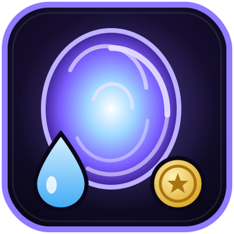
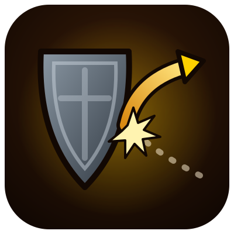

# WoW Forever Addons

Small addons for World of Warcraft: Forever (Interface 16001). Some work on any class, some are for warriors only. None of them use the combat log, which Forever blocks for addons.

## Install

Copy whichever addon folders you want into `World of Warcraft\_forever_\Interface\AddOns` and `/reload`. Each addon works on its own. Enemy nameplates need to be on (V) for everything except Battle Shout Notice.

## Settings

Every addon has a settings page under **Options > AddOns**, and an entry on the minimap's addon button. Typing the slash command on its own (for example `/opp`) opens the page, and adding `help` (`/opp help`) lists the chat commands. The top of each page has a short "What's new" list for the last few versions.

**Update notice.** Addons can't go online, so each addon quietly tells guild and group members running it which version it's on. If someone has a newer one, you get a chat message saying it's out, and a reminder at each login until you update through the CurseForge app. Turn it off under "Updates" on the settings page.

## Any class

### Target Arrow (`/tarrow`)

A bobbing arrow above your target's nameplate so you can pick it out of a crowd. It sits high enough to clear the Overpower Plates icon if you use both.

- `/tarrow colour <red|yellow|green|blue|white>`
- `/tarrow size <n>`, `/tarrow offset <n>`, `/tarrow bob`, `/tarrow enemies`

### Plate Threat (`/pth`)

Shows your threat percentage on the left of each enemy nameplate in combat (100% = you have aggro), clear of the level box. Forever returns threat as secret values, so the number is displayed directly and is only coloured when the game allows the value to be read. May not show in instances.

Also adds a retail-style threat box on top of the target frame, coloured by your threat level. It can be moved or turned off on the settings page.

- `/pth test`, `/pth left`, `/pth right`, `/pth size <n>`, `/pth gap <n>`, `/pth portrait`

## Mage

### Mage Services (`/ms`)

Spots people asking for portals or water in chat and lists them in a small window, each with **Invite** and **Whisper** buttons. Whisper opens your chat box with a reply already typed, so you just press Enter. The replies are edited on the settings page (`{name}`, `{dest}` and `{zone}` are filled in), and there's an optional automatic reply for people who whisper you directly: never for Trade or General posts, at most once per player every few minutes, with a separate reply when you can't help. Matching is loose: it ignores case and punctuation, allows small typos, understands city shorthand (UC, TB, Org, SW, IF, Darn), and ignores other mages' adverts ("WTS portals"). Auto-invite is available but off by default. Works on any class, but it's made for mages.

**Location priority.** Requests are ranked against where you are (detected automatically, or pick a city with `/ms zone`):
- **Top, highlighted:** asked in your zone's General channel or in say/yell, said "from <your zone>", or a /who shows them in your zone.
- **Middle:** location unknown (Trade, whispers, guild). Click **?** on the row to run a /who and re-rank it. The game only allows /who from a click, so this can't run automatically.
- **Bottom, dimmed:** they're somewhere else, they want a port to the city you're already in, or they want a portal you don't have yet. Can be hidden instead, and there's a separate option to hide requests that don't say where the player is.

**On-screen alerts.** The matching Portal or Conjure button on your action bars glows (Blizzard bars, Bartender4, ElvUI and Dominos), a message shows at the top of the screen, and the screen edges flash. Each can be turned off.

**Portal button.** A big icon at the top-left of the window casts the portal for the selected request (or Conjure Water for a water request). The top request is picked automatically; click a row to pick another. It can be bound to a key under Key Bindings > AddOns. It updates as soon as combat ends, since the game doesn't allow spell buttons to change during combat.

**Payment messages.** After a trade with someone who asked (or is in your group), it posts the result: payment received (gold and any items), completed with no payment, cancelled, or failed with the reason. It uses party chat if they're still in your group, otherwise it whispers them. Choose whether it sends automatically, only types it into your chat box for you to send, or stays off.

**Earnings.** Gold received is totalled per character, split into portals (with a per-city breakdown), water/food and other, plus a total for the current session. It's shown at the bottom of the window, on the settings page and with `/ms earnings`.

Forever hides chat text from addons inside dungeons, raids, M+ and PvP, so it only works out in the world.

- `/ms theme [dark|light]` window theme (also on the settings page)
- `/ms sounds`, `/ms sound <number>` list and pick the alert sound (also a dropdown on the settings page)
- `/ms earnings` totals (all characters, this character, this session, split into portals and food & water); `/ms earnings reset` for clearing options
- `/ms receipts [auto|prefill|off]` how payment messages are posted
- `/ms paidmsg`, `/ms nopaymsg`, `/ms cancelmsg`, `/ms failmsg <text>` change them (`{name}`, `{amount}`, `{reason}` are filled in)
- `/ms testtrade [complete|cancelled|failed]` preview a payment message (typed only, never sent)
- `/ms zone [auto|city|zone]` show or set your location, e.g. `/ms zone uc`
- `/ms add <phrase>` watch for your own phrase too, e.g. `/ms add lf summon`; `/ms list`, `/ms remove <n>`
- `/ms exclude <phrase>` never match lines containing it; `/ms excludes`, `/ms unexclude <n>`
- `/ms portmsg <text>`, `/ms watermsg <text>`, `/ms custommsg <text>`, `/ms cantmsg <text>` change the replies
- `/ms autoreply` turns automatic replies to whispers on or off
- `/ms test` add sample requests, `/ms show` show the window

## Warrior only

These do nothing on other classes.

### Overpower Plates (`/opp`)

Puts an Overpower icon with a 5 second countdown above the nameplate of the mob that dodged you, including off-target dodges from Whirlwind and Cleave. A nameplate dodge only counts when your Overpower charge (combo point) goes up at the same moment, so dodges against other players are ignored.

While Overpower is up, a gold glow pulses around the icon and your Overpower button glows on the action bars (Blizzard bars, Bartender4, ElvUI and Dominos). There's also an optional big Overpower icon in the middle of the screen that you can move and resize.

- `/opp test` show the icon on every nameplate (and the glow and screen icon)
- `/opp size <n>`, `/opp offset <n>`, `/opp window <n>`
- `/opp sound` toggle the dodge sound
- `/opp glow` toggle the action bar glow, `/opp screen` toggle the screen icon, `/opp move` place it
- `/opp debug` print your Overpower charges and which action buttons hold Overpower

### Battle Shout Notice (`/bsr` or `/bsn`)

Shows a Battle Shout icon when the buff is missing or under 10 seconds while you're in combat or targeting an enemy. Forever hides buffs from addons in combat, so it times your own casts and checks the real buff out of combat.

- `/bsr unlock`, `/bsr lock` move the icon
- `/bsr test`, `/bsr time <n>`, `/bsr size <n>`, `/bsr sound`, `/bsr reset`

## Problems and ideas

Found a bug or want something changed? [Open an issue](https://github.com/miff88/wow-forever-addons/issues/new/choose) and pick the addon. For errors, include the Lua error text (type `/console scriptErrors 1`, then `/reload`, to see them).

## Licence

All rights reserved. The addons are free to download and use, but please don't copy or republish them. See [LICENSE](LICENSE).

## Releasing

Releases are automatic. When a new version (the `## Version:` line in an addon's .toc) reaches `main`, the "Release addons" workflow uploads it to CurseForge as a WoW Forever (1.60.1) file and creates a GitHub release and tag `<Addon>-v<version>` with the same zip. Only addons listed in `curseforge.json` are released. CurseForge uploads need the `CF_API_TOKEN` repository secret. The workflow can also be run by hand from the Actions tab, and a failed upload is retried on the next run.
