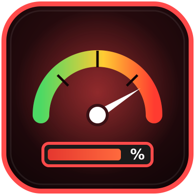
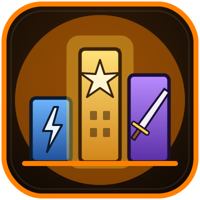
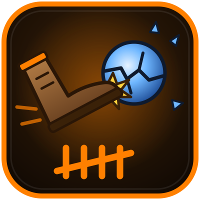
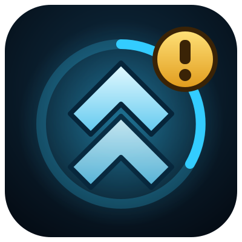
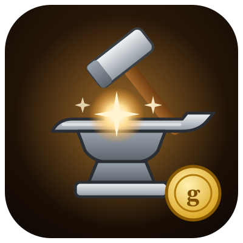

# WoW Forever Addons

Small addons for World of Warcraft: Forever (Interface 16001). They all work on any class; Craft Services is for anyone with a profession (and rogues, for lockboxes), and Mage Services is made for mages. None of them use the combat log, which Forever blocks for addons.

## Install

Copy whichever addon folders you want into `World of Warcraft\_forever_\Interface\AddOns` and `/reload`. Each addon works on its own. Enemy nameplates (V) need to be on for Target Arrow, Plate Threat's numbers and Proc City's Overpower icon, and Kick Tally and Kill Clock work best with them on.

## Settings

Every addon has a settings page under **Options > AddOns**, and an entry on the minimap's addon button. Typing the slash command on its own (for example `/proc`) opens the page, and adding `help` (`/proc help`) lists the chat commands. The top of each page has a short "What's new" list for the last few versions.

**Update notice.** Addons can't go online, so each addon quietly tells guild and group members running it which version it's on. If someone has a newer one, you get a chat message saying it's out, and a reminder at each login until you update through the CurseForge app. Turn it off under "Updates" on the settings page.

## Any class

### Target Arrow (`/tarrow`)

A bobbing arrow above your target's nameplate so you can pick it out of a crowd. It sits high enough to clear Proc City's Overpower nameplate icon if you use both.

An optional second, smaller arrow marks your focus or a raid marker (skull by default) in its own colour, and hides when it would point at your target.

- `/tarrow colour <red|yellow|green|blue|white|purple|orange>`
- `/tarrow size <n>`, `/tarrow offset <n>`, `/tarrow bob`, `/tarrow enemies`
- `/tarrow focus`, `/tarrow marker <skull|cross|square|moon|triangle|diamond|circle|star>`, `/tarrow second <colour|off>`

### Plate Threat (`/pth`)

Shows your threat percentage on the left of each enemy nameplate in combat (100% = you have aggro), clear of the level box. Forever returns threat as secret values, so the number is displayed directly and is only coloured when the game allows the value to be read. May not show in instances.

Also adds a retail-style threat box on top of the target frame, coloured by your threat level. It can be moved or turned off on the settings page.

**Aggro warning** (in a party or raid): a big flashing message and a sound. Not tanking, it says "About to pull aggro" when you're above the tank and "You have aggro!" once a mob turns to you. Tanking, it says "Losing aggro" when someone is close to taking a mob and "Lost aggro!" when they have. It works out whether you're the tank from your group role, or Defensive Stance and Bear Form, and you can set it yourself.

- `/pth test`, `/pth left`, `/pth right`, `/pth size <n>`, `/pth gap <n>`, `/pth portrait`
- `/pth warn` aggro warning on or off, `/pth tank`, `/pth dps`, `/pth auto`, `/pth move` place the warning

### Proc City (`/proc`)

Your procs and short buffs as a movable row of icons, with the time left on each: Flurry, Enrage, Blood Craze, Clearcasting, Vengeance, Shadow Trance, Quick Shots, Crusader (Holy Strength), the new Forever enchants Insight and Revelation, every Forever weapon that buffs you (Destiny, Arcanite Champion, Ragehammer, Hand of Edward the Odd and more), item procs, on-use trinkets, class cooldowns and racials, for every class. Icons grow to the right or left as procs happen. When Crusader is up on both weapons at once, its icon glows. Any equipped trinket with a Use is picked up automatically, even if it's new to Forever.

**After a dodge, parry or block.** Overpower, Revenge (warriors), Riposte (rogues), Counterattack and Mongoose Bite (hunters) join the row for their 5 second window, and their buttons glow on your action bars. Overpower also puts an icon on the nameplate of the mob that dodged you, including off-target dodges from Whirlwind and Cleave: a nameplate dodge only counts when your Overpower charge goes up at the same moment, so dodges against other players are ignored. The others only show while the game says you can cast them, and go away once you use them. Mongoose Bite only shows when the game confirms it, since your target dodging your pet looks the same as dodging you. This used to be Proc Plates (Overpower Plates). Shadow Trance also lights your Shadow Bolt buttons.

**Pinned procs.** Pin the ones you build around (Flurry, Crusader, Enrage...) on the settings page or with `/proc pin <name>`. They come first, always in the same place, and stay as a faint grey icon while they're down, so a missing proc is as easy to spot as a running one. By default the grey icons only show in combat. The first time each class logs in, a few starter pins are set for it if the character has them (warriors: Overpower, Flurry and Crusader; mages: Clearcasting; and so on); unpin any you don't want and they stay unpinned.

Forever hides buff details from addons in combat. Out of combat Proc City reads your buffs exactly, and learns each buff's real Forever duration. In combat it works from what the game still shows: your own casts (trinkets, cooldowns), your Strength (Crusader and other Strength procs, which is also how it tells one Crusader from two) and the game's combat text, then corrects itself when combat ends. Procs it has no in-combat signal for may only appear out of combat; `/proc debug` prints what it sees during a fight, which tells us what to add.

- `/proc test` show test icons, `/proc move` move them (`/proc lock` when done), `/proc reset`
- `/proc grow left|right`, `/proc size <n>`
- `/proc list` what's tracked for your class, `/proc off <name>` / `/proc on <name>`
- `/proc pin <name>` / `/proc unpin <name>` keep it on screen, greyed out while it's down
- `/proc glow` the action button glow, `/proc plates` the Overpower nameplate icon
- `/proc debug` print casts, Strength changes, combat text, dodges and parries in combat

### Kick Tally (`/ktally`, also `/kicks`)

Announces your successful interrupts in chat ("Pummel interrupted Defias Pillager's Fireball!") and keeps a window, styled like the game's own damage meter, with how many kicks each person in your party or raid has landed: class-coloured bars, C / O for this fight or overall, a gear menu and a minimise button. Hover a row to see what that player kicked. Counts Pummel, Shield Bash, Kick, Counterspell, Earth Shock, Spell Lock, Feral Charge and Silence, plus (optionally) stuns and fears that stop a cast, like Hammer of Justice or Kidney Shot. It also tells you, in your own chat window, when your kick didn't interrupt anything.

How it works on Forever: your own kicks are exact. Kick Tally sees you cast the interrupt and the enemy's cast being interrupted. In combat the game hides which spells other players cast, so a party or raid member's kick is counted when their cast lands at the same moment an enemy's cast is interrupted. Group members who also run Kick Tally send you their own kicks instead, which is exact (addons can't message each other during boss fights, M+ or PvP, so there it goes back to timing). Keep enemy nameplates on so it sees every enemy. The game blocks addon chat messages during boss fights, so there your kicks go to your own chat window, and the fight's tally can be posted to the group when the boss dies. In dungeon fights the game also hides enemies' names and spells, so Kick Tally remembers names from before the pull (nameplates, your target) and uses raid markers; a kick it can't name goes only to your own chat window unless you choose otherwise.

- Announce to auto (instance, raid or party chat), party, raid, instance, say or yell (say and yell only inside instances), or only yourself. The message is editable: `{target}`, `{spell}`, `{ability}`, `{count}`.
- Interrupt cooldowns show over the class icons, counting down: yours, and those of group members who run Kick Tally (or whose kick the game shows).
- Drag the bottom-right corner to resize it; the mouse wheel scrolls when there are more players than fit. Show or hide the window, or only show it in a party or raid. Bar height, background and window opacity are on the settings page.
- `/ktally test`, `/ktally report` (or `report total`) post the tally to the group, `/ktally lock|unlock`, `/ktally show|hide`, `/ktally reset` (or `reset position`); "Reset all data" is also in the window's C / O and gear menus
- `/ktally debug` print the casts and interrupts it sees

### Kill Clock (`/kclock`)

A countdown just right of the target frame's portrait showing roughly how long until your target dies (`1:24`), so you can time cooldowns and executes. It's how long the target will take at the pace it has lost health so far. Drag it anywhere; pick the text size, a colour (white, yellow, orange, red, green, blue, purple, pink, or any colour from the colour picker), an outline and an optional "Dies in" label. It can be limited to elites, rares and bosses.

A smaller line underneath shows how long until the target reaches execute range (`20% in 0:12`), on by default for warriors and paladins; the percentage can be changed. An optional second clock sits beside the focus frame.

How it works on Forever: the game hides enemy health from addons in combat, so they can show it but can't do maths with it. Kill Clock never reads the health. Twice a second it gives the game a lookup ("curve") from health left to time left at the current pace, and the game applies it to the hidden health and shows the answer. Keep enemy nameplates on so it knows when each mob started taking damage, even after you switch targets.

- `/kclock test`, `/kclock move` (`/kclock lock` when done), `/kclock reset` (back beside the target frame)
- `/kclock size <n>`, `/kclock colour <name>` (no name opens the colour picker), `/kclock debug`
- `/kclock execute` the execute line on or off, `/kclock execute <n>` sets its percentage, `/kclock focus` the focus clock

### Buff Notice (`/bsn`, also `/bsr`)

Formerly Battle Shout Notice. Shows an icon when a buff your class keeps up is missing or about to run out: Battle Shout (while fighting), Arcane Intellect and mage armors, Fortitude, Inner Fire and Divine Spirit, Mark of the Wild and Omen of Clarity, Blessings, Demon Armor, Lightning Shield and shaman weapon imbues, Aspects and Trueshot Aura, and rogue poisons on each weapon. Only buffs you know are watched, and each can be turned off.

- Red and pulsing: missing. Gold with seconds: running out (10 seconds for short buffs, 60 for long ones, both adjustable).
- Blue with a number: that many party or raid members nearby are missing your group buff (Intellect and Spirit skip warriors and rogues).
- Optional food and flask/elixir reminder in dungeons and raids.
- Quiet in cities and inns. Forever hides buffs from addons in combat, so it checks them out of combat and times them from your own casts in between.
- `/bsn unlock`, `/bsn lock` move the icons, `/bsn test`, `/bsn list` the buffs it watches, `/bsn time <n>`, `/bsn size <n>`, `/bsn sound`, `/bsn reset`

## Professions

### Craft Services (`/cs`)

Spots people asking for enchants, crafts and lockboxes in chat, for every profession: Enchanting, Blacksmithing, Leatherworking, Tailoring, Alchemy, Engineering, Jewelcrafting, Inscription, Cooking and First Aid, plus Lockpicking for rogues. Requests are listed in a small window with **Invite** and **Whisper** buttons, like Mage Services.

**It knows your recipes.** Open each profession window once and it reads every recipe you've learned, with its materials and description (it updates whenever you learn something). That's how it tells "you know this and have the mats" from "you don't have this recipe".

**Matching.** It understands links (recipe, item or enchant), recipe names ("runecloth bag"), and enchant nicknames: "crusader", "+7 agi gloves", "minor speed boots", "2h int". When a nickname could mean two enchants it asks what they want rather than guessing. It notices who brings the mats ("have mats", "your mats"), ignores other crafters' adverts ("WTS", "LFW") and never picks up mage requests (ports, water). Typos are allowed ("firey", "enchnter") as long as the first letter is right.

**Which professions.** It only watches the professions ticked on the settings page. The ones you've trained start ticked; tick any others you want to see, such as one an alt has.

**Replies** fill in the recipe, your price, the mats, what you're short of and their place in the queue: "Hi Ana, I can do Enchant Weapon - Crusader for you for 5g. You're #2 in line. Sending you an invite." Edit them on the settings page. Automatic replies (whispers only) and automatic invites (only when you know the recipe and have the mats, or they bring them) are there but off by default.

**Customers, start to finish.** Each request moves through *replied*, *invited*, *in your group*, *mats received*, *trading* and *paid*, and the title shows how many are in your queue. People you're helping stay listed while you work, and come back to the list if they leave and return. Repeat customers are tagged "regular".

**Trade helper.** A panel beside the trade window shows what they asked for, a mats checklist (what's in your bags and what they're handing over), their item in the "will not be traded" slot (whether the enchant fits it, or for a lockbox whether it's locked and your lockpicking is high enough), and what they're offering against your price. Its buttons:
- **Enchant their item**: the first click opens the recipe, the next one puts the enchant on their item.
- **Pick Lock**: casts it on their box.
- **Open recipe**: opens your profession at the recipe.
- **Ask to pay** and **Ask for mats**: a whisper (or party message) with your price or what's still missing.

**Profession button.** The big icon at the top-left of the window opens your profession at the recipe the selected request wants (or casts Pick Lock for a lockbox). Bind it to a key under Key Bindings > AddOns.

**Prices and advert.** Set prices with `/cs price crusader 5g` or on the settings page; they go into replies and the trade panel. Mark recipes to feature with `/cs feature crusader`, and the **Advertise** button posts "LFW Enchanter and Tailor in Orgrimmar: Crusader, Minor Speed. Whisper me!" in Trade (at most every 3 minutes; the game only allows it from a click or key press). Featured recipes you don't have the mats for are left out unless you choose otherwise.

**Payments and earnings.** After a trade it posts the result (payment received, mats received, cancelled or failed) in party chat or a whisper, and totals your earnings by profession and by recipe, per character and across all characters. Optionally (off by default) customers who've paid are removed from your group after a short wait, but only people you invited, only while you lead, and never in combat.

Forever hides chat text from addons inside dungeons, raids, M+ and PvP, so it only works out in the world.

- `/cs recipes` what it knows of your professions; `/cs can <recipe>` do you know it and have the mats
- `/cs price <recipe> <amount>`, `/cs prices`; `/cs feature <recipe>`, `/cs featured`
- `/cs ad` post your advert; `/cs shopping` mats you're short of for the current requests
- `/cs customers` your best customers (`/cs customers forget yes` clears them)
- `/cs autoreply`, `/cs autoinvite` turn those on or off
- `/cs pause`, `/cs resume`; `/cs filter here|nearby|all`; `/cs zone [auto|city]`
- `/cs add <phrase>`, `/cs list`, `/cs remove <n>`; `/cs exclude <phrase>`, `/cs excludes`, `/cs unexclude <n>`
- `/cs earnings`, `/cs receipts [auto|prefill|off]`, `/cs theme`, `/cs sounds`
- `/cs test` add sample requests, `/cs testtrade [complete|mats|cancelled|failed]` preview a payment message, `/cs show`

## Mage

### Mage Services (`/ms`)

Spots people asking for portals or water in chat and lists them in a small window, each with **Invite** and **Whisper** buttons. Whisper opens your chat box with a reply already typed, so you just press Enter. The replies are edited on the settings page (`{name}`, `{dest}` and `{zone}` are filled in), and there's an optional automatic reply for people who whisper you directly: never for Trade or General posts, at most once per player every few minutes, with a separate reply when you can't help. Matching is loose: it ignores case and punctuation, allows small typos, understands city shorthand (UC, TB, Org, SW, IF, Darn), and ignores other mages' adverts ("WTS portals"). Auto-invite is available but off by default. Works on any class, but it's made for mages.

**Location priority.** Requests are ranked against where you are (detected automatically, or pick a city with `/ms zone`):
- **Your zone:** asked in your zone's General or LocalDefense channel, in say/yell where you're standing, said "from <your zone>", is a guildmate or friend whose list entry shows your zone, or a /who shows them there.
- **Unknown:** Trade chat reaches every city, so Trade (and whispers) only count as your zone if one of the above applies. Click **?** on the row to run a /who; the game only allows /who from a click, so it can't run automatically.
- **Elsewhere:** they're in another zone, want a port to the city you're already in, or want a portal you don't have yet.

**Show requests from** (settings, or `/ms filter here|nearby|all`): *Your city only*, *Your city + unknown* (the default), or *Everywhere* with the rest dimmed. The window title shows how many were hidden.

**Pause.** The window's **Pause** button (or `/ms pause`, or a key binding) stops taking requests on that character: no list, alerts, glows or replies until you press **Resume**. While paused the window shrinks to a slim bar with the Resume button; close it with x if you like. Payment messages for people you've already served still work.

**Group trips.** When two or more people want the same city, their rows get an **All** button (e.g. "All 3") that invites everyone going there at once, so one portal serves them all. Optionally (off by default), once your portal is up, customers who were standing with you are removed from the group as they go through, so there's room for the next lot. It only removes people you invited from Mage Services or who asked you in chat, and only while you lead the group.

**Advertise.** The **Advertise** button on the window (or `/ms ad`, or a key binding) posts your own advert in Trade, General, say or yell: by default "Mage in Orgrimmar selling portals to UC and TB, plus food and water. Whisper me!", listing the portals this character actually has. It goes out at most once every 3 minutes (adjustable), and the button counts down until the next one. The game only lets addons post in channels from a click or key press, so it never posts by itself. The text is edited on the settings page, and an optional slim bar keeps the button on screen when there are no requests.

**Runes.** The bottom right of the window shows how many Runes of Teleportation and Runes of Portals you carry, and you get a chat warning when Runes of Portals drop below 5 (adjustable). The warning starts once it has seen a portal use a rune.

**On-screen alerts.** The matching Portal or Conjure button on your action bars glows (Blizzard bars, Bartender4, ElvUI and Dominos), a message shows at the top of the screen, and the screen edges flash. Each can be turned off.

**Portal button.** A big icon at the top-left of the window casts the portal for the selected request (or Conjure Water for a water request). The top request is picked automatically; click a row to pick another. It can be bound to a key under Key Bindings > AddOns. It updates as soon as combat ends, since the game doesn't allow spell buttons to change during combat.

**Payment messages.** After a trade with someone who asked (or is in your group), it posts the result: payment received (gold and any items), completed with no payment, cancelled, or failed with the reason. It uses party chat if they're still in your group, otherwise it whispers them. Choose whether it sends automatically, only types it into your chat box for you to send, or stays off.

**Earnings.** Gold received is totalled per character, split into portals (with a per-city breakdown), water/food and other, plus a total for the current session. It's shown at the bottom of the window, on the settings page and with `/ms earnings`.

Forever hides chat text from addons inside dungeons, raids, M+ and PvP, so it only works out in the world.

- `/ms theme [dark|light]` window theme (also on the settings page)
- `/ms sounds`, `/ms sound <number>` list and pick the alert sound (also a dropdown on the settings page)
- `/ms earnings` totals (all characters, this character, this session, split into portals and food & water); `/ms earnings reset` for clearing options
- `/ms receipts [auto|prefill|off]` how payment messages are posted
- `/ms paidmsg`, `/ms nopaymsg`, `/ms cancelmsg`, `/ms failmsg <text>` change them (`{name}`, `{amount}`, `{reason}` are filled in)
- `/ms testtrade [complete|cancelled|failed]` preview a payment message (typed only, never sent)
- `/ms zone [auto|city|zone]` show or set your location, e.g. `/ms zone uc`
- `/ms pause`, `/ms resume` stop or start taking requests on this character
- `/ms filter here|nearby|all` which requests to show
- `/ms add <phrase>` watch for your own phrase too, e.g. `/ms add lf summon`; `/ms list`, `/ms remove <n>`
- `/ms exclude <phrase>` never match lines containing it; `/ms excludes`, `/ms unexclude <n>`
- `/ms portmsg <text>`, `/ms watermsg <text>`, `/ms custommsg <text>`, `/ms cantmsg <text>` change the replies
- `/ms autoreply` turns automatic replies to whispers on or off
- `/ms ad` post your advert
- `/ms test` add sample requests, `/ms show` show the window

## Retired

**Proc Plates** (formerly Overpower Plates) is now part of Proc City. Its last version hands over to Proc City 1.4.0 or later, which brings its settings with it, so the `OverpowerPlates` folder can be deleted once Proc City is installed.

## Problems and ideas

Found a bug or want something changed? [Open an issue](https://github.com/miff88/wow-forever-addons/issues/new/choose) and pick the addon. For errors, include the Lua error text (type `/console scriptErrors 1`, then `/reload`, to see them).

## Licence

All rights reserved. The addons are free to download and use, but please don't copy or republish them. See [LICENSE](LICENSE).

## Releasing

Releases are automatic. When a new version (the `## Version:` line in an addon's .toc) reaches `main`, the "Release addons" workflow uploads it to CurseForge as a WoW Forever (1.60.1) file and creates a GitHub release and tag `<Addon>-v<version>` with the same zip. Only addons listed in `curseforge.json` are released. CurseForge uploads need the `CF_API_TOKEN` repository secret. The workflow can also be run by hand from the Actions tab, and a failed upload is retried on the next run.
